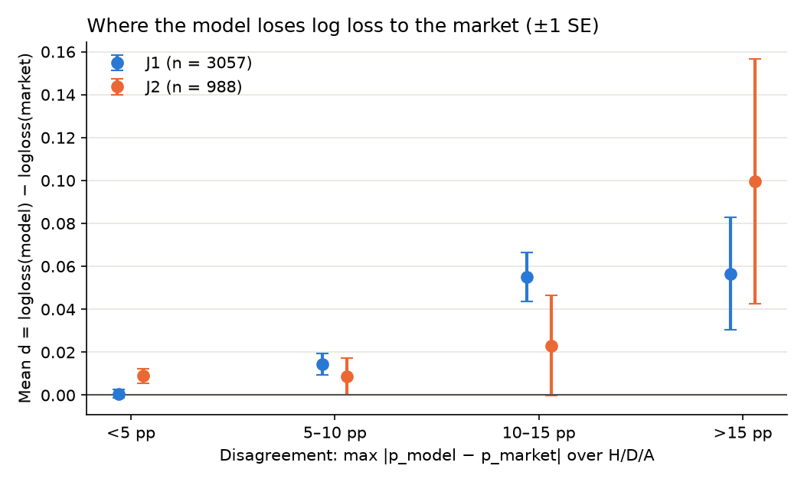
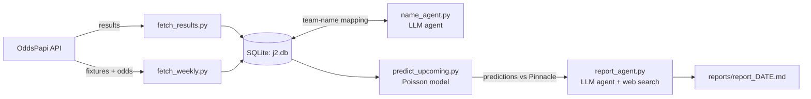

# J2/J1 Forecast – Can a simple Poisson model beat the betting market?
I rebuilt my Excel betting model in Python, tested it honestly against the betting market, and turned the manual weekly workflow into an automated pipeline with two LLM agents.

## Key findings

- **The model has no edge.** It beats a naive baseline but loses to the market by 0.016-0.018 log loss - in all 14 J1 seasons (3,057 matches, Pinnacle closing odds) and all 3 J2 seasons (988). The 20-40% "edges" that were existing within the Excel model were model error.

- **The model loses where it disagrees with the market.** When market and model agree, the model is almost as good as Pinnacle. Most of the gap comes from underrating favourites.

- **A promising improvement did not survive out-of-sample.** Last season's xG as a starting point passed a pre-registered test on 2023-24 by 0.0002 - and shrank to noise on 2025. It was not added to the pipeline.

- **The weekly pipeline runs on its own** (GitHub Actions, twice a week) for about $0.50 per month. Code does everything with a right answer; LLM agents only match team names and interpret news - and code validates their output.

**Stack:** Python (pandas, requests, BeautifulSoup, matplotlib), SQLite, GitHub Actions, Anthropic API (tool use, own agent loop – no framework), pytest.

> Not betting advice.

---

## Part 1 – Does the model beat the market?

### 1. Problem

My Excel Poisson model for the Japanese J2 league regularly reported "edges" of 20-40% against bookmaker odds - too high not to be suspicious of. The question: **Does a team-strength Poisson model produce better probabilities than the betting market?**

### 2. Data

| Source                   | Content                                                       | Used for                         |
|--------------------------|---------------------------------------------------------------|----------------------------------|
| API-Football (free tier) | J2 results 2022–2024 (1,304 regular-season matches)           | Model development, choice of k   |
| football-data.co.uk      | J1 results + Pinnacle closing odds 2012–2025 (4,613 matches)  | Market comparison (sharp market) |
| CheckBestOdds            | J2 odds 2022–2024 (1,301 matches)                             | Market comparison (J2)           |
| OddsPapi (free tier)     | Current J2 fixtures, results and odds                         | Weekly pipeline (part 2)         |

Data quality issues found and handled:
- Promotion play-off matches (3 per season) excluded - not regular league matches.
- The J1 file stores the league as both "J1 League" and " J1 League" (leading space). Filtering without stripping would silently drop ~50 % of matches.
- 12 J2 teams are named differently in the two J2 sources. Mapped manually and verified: The winner matches in all 1,301 games.

### 3. Method

**Model.**
Each team gets an attack and a defence rating relative to the league average. Expected goals:

```
λ_home = league avg home goals × attack(home) × defence(away)
λ_away = league avg away goals × attack(away) × defence(home)
```

Goals follow independent Poisson distributions; summing all scorelines gives P(home), P(draw), P(away).

**Shrinkage (k).** Early in a season, ratings are noisy. Each team gets k "virtual" average matches, pulling ratings towards the average until real data takes over. k=0 was clearly worst (log loss 1.0635), k=10-15 best (1.0490). k=12 is used.

**Walk-forward backtest.** For every match day, the model only sees matches played before that day - no look-ahead bias.

**Market comparison.** The bookmaker margin is removed by scaling implied probabilities to sum to 1. Pinnacle closing odds are the hardest benchmark: low margin, most information

**Metric.** Log loss=average of -log(probability given to the actual outcome). Lower is better. It punishes confident wrong predictions hard - the penalty goes to infinity as the probability approaches 0.

### 4. Results

**Decision rule (set before running the test):** if the model is more than 0.01 log loss worse than the market, it has no edge.

|                         | J1 vs. Pinnacle (3,057 matches) | J2 vs. CheckBestOdds (988 matches) |
|-------------------------|---------------------------------|------------------------------------|
| Baseline                | 1.0822                          | 1.0887                             |
| Model                   | 1.0475                          | 1.0513                             |
| Market (margin removed) | 1.0292                          | 1.0357                             |
| Gap model – market      | 0.018 (all 14 seasons)          | 0.016 (all 3 seasons)              |

**Betting simulation (J1)** – bet 1 unit whenever model edge (p × odds − 1) exceeds a threshold:

| Odds             | Edge > | Bets  | ROI    | ± 1 SE |
|------------------|--------|-------|--------|--------|
| Pinnacle closing | 0 %    | 3,679 | −4.0 % | 2.7 %  |
| Pinnacle closing | 20 %   | 1,192 | −4.6 % | 5.2 %  |
| Best available   | 0 %    | 4,245 | −0.1 % | 2.6 %  |

Bets with model edges above 20 % lost money: the large edges were model error, not market error. **Conclusion: no edge. Betting on the model was stopped.**

### 5. Where does the model lose?

Per-match diagnostic ([reports/diagnose_gap.md](reports/diagnose_gap.md)):



- **When model and market agree (< 5 pp), the model is almost as good as Pinnacle** (J1: +0.0007 per match). In J1, 71% of the gap comes from the 24% of matches with more than 10pp disagreements.
- **The model underrates favourites.** J1 favourites win 48.4 %; the model says 44.9 %, the market 47.4 %. Likely cause: shrinkage and restarting every season pull strong teams together. J2 points in the same way, but within noise.
- **Draws are not the problem** – the model's draw rate matches reality in both leagues.
- **Implication:** large model-market disagreements are mostly model error - which is why the report agent (part 2) is tested on exactly those matches.

### 6. Follow-up: does last season's xG help?

Idea: start each team from last season's xG rating instead of the league average. Both tests were pre-registered (rule committed before running them): the xG version must improve log loss by **at least 0.005**.

| Test                                      | Matches | Improvement | ± 1 SE | Verdict              |
|-------------------------------------------|---------|-------------|--------|----------------------|
| J2 2023–24 (where the idea was developed) | 800     | −0.0052     | 0.0036 | Passes by 0.0002     |
| J2 2025 (out-of-sample)                   | 360     | −0.0011     | 0.0047 | Fails – within noise |

The 2023–24 result was most likely partly luck. **Not added to the pipeline.** Full method and secondary variants: [src/backtest_xg_prior.py](src/backtest_xg_prior.py).

### 7. Limitations

- **J2 odds quality.** CheckBestOdds is a weaker benchmark than Pinnacle - the model still loses to it.
- **Missing information.** The model only uses goals; the market also prices injuries, line-ups, xG etc.
- **Season-only data.** The model restarts every season.
- **k tuned on J2.** The J2 market test is therefore slightly flattering to the model; J1 is out-of-sample. Neither changes the conclusion.

---

## Part 2 – Automated weekly pipeline with LLM agents

The manual workflow (Excel, chatbot, hand-written bet log) now runs on its own every Monday and Thursday on GitHub Actions, and commits the updated database and report back to the repo.

> **This is the public copy of a private repo.** The pipeline runs in the private repo,
> because the database holds third-party results and odds (football-data.co.uk,
> CheckBestOdds, API-Football, OddsPapi) that I don't redistribute. Code, reports and
> evaluation are identical; `data/` is left out. The workflow is included as
> documentation and only runs in the private repo.



**Design principle: code for anything with a right answer, LLM only where judgement is needed.**

### The two agents

Both use the same small agent loop (`src/agent.py`, no framework): the model picks tools, my code runs them and returns the results.

| Agent           | Task                                                                                                                              | Tools                                  | Code validates                                   |
|-----------------|-----------------------------------------------------------------------------------------------------------------------------------|----------------------------------------|--------------------------------------------------|
| name_agent.py   | Map OddsPapi team names to the model's names                                                                                      | run_sql (read-only), save_team_mapping | Every team mapped, names exist, no duplicates    |
| report_agent.py | For the 3 biggest model–market disagreements: find news, pick a lean (market or model) backed by one checkable fact, give its own H/D/A forecast | web_search, run_sql, save_report       | Exact team names, sources with links, max length |

### Evaluation

- **Name agent:** 20/20 teams correct in 5/5 runs. ≈ $0.002 per run.
- **Report agent – facts:** first report 9/11 checkable claims correct (2 home/away mix-ups). Fix: code now computes each team's last 5 results and passes them in – facts from code, judgement from the LLM. Next report: 9/9.
- **Report agent – can it beat the market?** Its forecasts are scored against model and market by log loss ([reports/evaluation.md](reports/evaluation.md)). Pre-registered rule: it only counts if it beats Pinnacle over at least 30 settled matches. Expected: it won't.
- **Locked, binary verdicts.** An earlier three-level scale came out "partly" 13 times out of 15 and measured nothing. The agent now picks a side, and only its *first* call per match is scored, so a re-run cannot replace a wrong call.
- **Model vs. market, live:** every match is scored in `reports/evaluation.md`, so the backtest gap can be checked week by week. Live odds are taken up to 4 days before kick-off, not at closing, so the live gap is not directly comparable to the backtest.
- **Known weakness:** an LLM asked to explain a disagreement will usually find an explanation. Only the results can tell.

### Safeguards

| Risk                    | Safeguard                                                                                    |
|-------------------------|----------------------------------------------------------------------------------------------|
| Runaway agent loop      | Max turns and token budget per run                                                           |
| Agent changes data      | Database opened read-only and only SELECT allowed                                            |
| Wrong LLM output        | Every save goes through validation that can reject it                                        |
| API costs               | $5 monthly limit, cheapest model, max 6 web searches per report, cost logged per run         |
| API quota / rate limits | Call cap per run, odds only ≤ 4 days before kick-off, retry with backoff                     |
| Truncated tool calls    | Rejected; the agent is asked to retry shorter (found in production, not in local tests)      |
| Traceability            | Every agent run logged to data/agent_log.jsonl; every prediction stored with timestamp       |

---

## Tests

`uv run pytest` – 7 tests of the parts the conclusions rest on.

| Test                                          | Checks that…                                                                 |
|-----------------------------------------------|------------------------------------------------------------------------------|
| test_probabilities_sum_to_one                 | home/draw/away probabilities sum to 1                                        |
| test_no_vig_removes_margin                    | the bookmaker margin is removed before comparing with the market             |
| test_shrinkage_pulls_towards_average          | one big win doesn't make a team look like the best in the league             |
| test_no_look_ahead                            | changing all future results to 9–0 doesn't change today's predictions        |
| test_first_lean_is_locked                     | only the agent's first call per match counts, whatever the row order         |
| test_field_scored_from_first_row_that_has_it  | the scored forecast is the first one that exists, not the latest             |
| test_rerun_does_not_change_scored_lean        | end-to-end: a re-run with the opposite call doesn't change the evaluation    |

## How to run

```bash
uv sync                                   # install dependencies
# .env: APIFOOTBALL_KEY=..., ODDSPAPI_KEY=..., ANTHROPIC_API_KEY=...
```

**Part 1 – backtests**

```bash
uv run python src/fetch_history.py        # J2 results 2022–2024 -> data/j2.db
uv run python src/backtest.py             # J2 backtest + choice of k
uv run python src/import_j1.py            # J1 results + odds (JPN.xlsx from football-data.co.uk)
uv run python src/backtest_market.py      # J1: model vs. Pinnacle
uv run python src/fetch_cbo.py && uv run python src/parse_cbo.py   # J2 odds
uv run python src/backtest_j2_market.py   # J2: model vs. CheckBestOdds
uv run python src/backtest_xg_prior.py [2025]   # xG follow-up (section 6)
```

**Part 2 – weekly pipeline** (normally run by GitHub Actions)

```bash
uv run python src/fetch_results.py        # new results
uv run python src/fetch_weekly.py         # fixtures + odds
uv run python src/name_agent.py           # only when new team names appear
uv run python src/predict_upcoming.py     # predictions vs. market
uv run python src/report_agent.py         # weekly report -> reports/
```

## Next steps

- Fix the favourite underrating found in section 5 (e.g. carry part of last season's ratings over) – pre-register before testing.
- Newcomer priors for promoted/relegated teams – pre-registered test on 2026/27.
- After a full season: is the report agent better than the market over 30+ matches?
