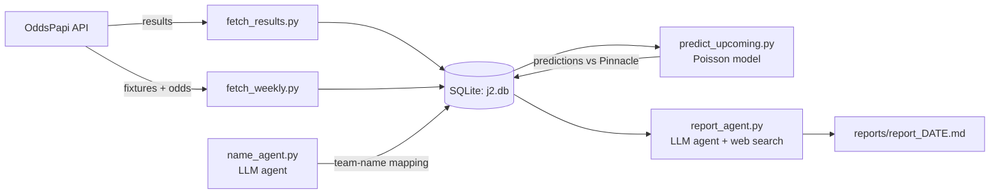

# J2/J1 Forecast – Can a simple Poisson model beat the betting market?

A two-part portfolio project:

1. **Analysis:** rebuild my Excel betting model in Python and test it honestly against the betting market.
2. **Engineering:** turn the manual weekly workflow into an automated pipeline with two LLM agents (tool use), running on GitHub Actions.

> Not betting advice. The main finding of part 1 is that the model has **no edge**.

---

## Part 1 – Does the model beat the market?

### 1. Problem

I built a Poisson goal model in Excel to find value bets in the Japanese J2 League.
The model regularly reported "edges" of 20–40 % against bookmaker odds – too high
not to be suspicious of.

The goal is to rebuild the model in Python and test it properly:
**Does a team-strength Poisson model produce better probabilities than the betting market?**

### 2. Data

| Source | Content | Used for |
|---|---|---|
| API-Football (free tier) | J2 results 2022–2024 (1,304 regular-season matches) | Model development, choice of k |
| football-data.co.uk | J1 results + Pinnacle closing odds 2012–2025 (4,613 matches) | Market comparison (sharp market) |
| CheckBestOdds | J2 odds 2022–2024 (1,301 matches) | Market comparison (J2) |
| OddsPapi (free tier) | Current J2 fixtures, results, Pinnacle / Mr Green / bet365 odds | Weekly pipeline (part 2) |
| Own Excel sheet (archived) | J2 results, rounds 1–10 of the 2026/27 season | One-off import as starting point for the current season – no longer updated |

Data quality issues found and handled:
- API data includes promotion play-off matches (3 per season) – excluded, as they are
  not regular league matches.
- The J1 file stores the league name both as "J1 League" and " J1 League" (leading space).
  Filtering without stripping would silently drop ~50 % of matches.
- Season is stored as both integers (2024) and text ("2026/2027") – normalised to start year.
- 12 J2 teams have different names in the two J2 sources (e.g. "Ichihara Chiba" vs.
  "JEF United Chiba"). Mapped manually and verified: the winner matches in all 1,301 games.

### 3. Method

**Model.** Each team gets an attack and a defence rating relative to the league average
(1.00 = average). Expected goals:

```
λ_home = league avg home goals × attack(home) × defence(away)
λ_away = league avg away goals × attack(away) × defence(home)
```

Goals are assumed to follow independent Poisson distributions. Summing the probabilities
of all scorelines (0–10 goals) gives P(home win), P(draw) and P(away win).

**Shrinkage (k).** With few matches, ratings are noisy – a team that scores 4 goals in one
match looks like a great attacking team. Each team is therefore given k "virtual"
league-average matches, pulling ratings towards 1.00. As a team plays more matches, its
own data takes over. Tested on J2 2022–2024: k = 0 (no shrinkage) was clearly worst
(log loss 1.0635), k = 10–15 best (1.0490). k = 12 is used.

**Walk-forward backtest.** For every match day, the model is trained *only* on matches
played before that day, then predicts that day's matches. This mirrors real use.
Training on the full season would let the model see the results it is predicting
(look-ahead bias) and make it look better than it actually is.
Predictions start once 100 matches of the season have been played.

**Market comparison.** Bookmaker odds contain a margin, so implied probabilities (1/odds)
sum to more than 100 %. The margin is removed by scaling the three implied probabilities
so they sum to 1. Pinnacle closing odds are used for J1 because Pinnacle is a low-margin,
sharp bookmaker and closing odds contain the most information – the hardest benchmark to beat.

**Metric.** Log loss = average of −log(probability assigned to the actual outcome).
It rewards confident correct predictions and heavily punishes confident wrong ones –
the penalty grows towards infinity as the probability given to the actual outcome
approaches 0. Lower is better. A naive baseline (league-wide home/draw/away frequencies)
is included to show whether the model adds anything at all.

### 4. Results

**Decision rule (set before running the test):** if the model's log loss is more than
0.01 worse than the market, the model has no edge and should not be used for betting.

#### J1 vs. Pinnacle closing odds – 2012–2025, 3,057 matches (k = 12)

| | Log loss |
|---|---|
| Baseline | 1.0822 |
| Model | 1.0475 |
| Market (Pinnacle, margin removed) | **1.0292** |

- The model beats the naive baseline, so team ratings contain real information.
- The market beats the model by 0.018 – **in all 14 seasons**.

**Betting simulation** – bet 1 unit whenever model edge (p × odds − 1) exceeds a threshold:

| Odds | Edge > | Bets | ROI | ± 1 SE |
|---|---|---|---|---|
| Pinnacle closing | 0 % | 3,679 | −4.0 % | 2.7 % |
| Pinnacle closing | 20 % | 1,192 | −4.6 % | 5.2 % |
| Best available | 0 % | 4,245 | −0.1 % | 2.6 % |

Bets where the model saw an edge above 20 % lost money. The large edges were model error,
not market error.

#### J2 vs. CheckBestOdds – 2022–2024, 988 matches (k = 12)

| | Log loss |
|---|---|
| Baseline | 1.0887 |
| Model | 1.0513 |
| Market (CheckBestOdds, margin removed) | **1.0357** |

- The market beats the model by 0.016 – **in all 3 seasons**.
- Betting on model edges: ROI between −4 % and 0 % (± 5–9 %) – no sign of an edge.

**Conclusion:** the model is 0.016–0.018 worse than the market in both leagues, well above
the 0.01 threshold. **The model has no edge.** The 20–40 % edges from the Excel model were
model error. Betting on the model was stopped.

### 5. Limitations

- **J2 odds quality.** CheckBestOdds shows "the last highest odds recorded" from an unknown
  set of bookmakers – a weaker benchmark than Pinnacle closing odds. The model still loses to it.
- **Closing vs. betting odds.** Bets were placed earlier in the week, at odds that may be
  easier to beat than closing odds.
- **Missing information.** The model only uses goals. The market also prices in injuries,
  line-ups, xG, travel and last season's form.
- **Season-only data.** The model restarts every season and ignores previous seasons.
- **Choice of k.** k was chosen on J2 data and evaluated on J1, so the J1 result is
  out-of-sample with respect to k. The J2 result is not: k was tuned on the same J2 matches
  used in the J2 market test, which slightly flatters the model. Since the model still loses
  to the market, this does not change the conclusion.

---

## Part 2 – Automated weekly pipeline with LLM agents

The weekly workflow used to be manual: type results and odds into Excel, run the model,
ask a chatbot about the matches, log bets by hand. It now runs on its own every Monday and
Thursday – Excel and the manual bet log are retired.

### Architecture



**Design principle: code for anything that has a right answer, LLM only where judgement
is needed.** Fetching data, the model and the choice of matches are deterministic code.
The LLM matches messy team names and interprets news.

### The two agents

Both use the same small agent loop (`src/agent.py`, no framework): the model chooses
tools, *my* code runs them and sends the results back, until the task is solved.

| Agent | Task | Tools | Validation (code checks the LLM) |
|---|---|---|---|
| `name_agent.py` | Map OddsPapi team names to the model's names (e.g. "RB Omiya Ardija" → "Omiya Ardija") | `run_sql` (read-only), `save_team_mapping` | Every team mapped, names must exist, no duplicates – otherwise rejected and the agent must fix it |
| `report_agent.py` | For the 3 matches where model and market disagree most: find news (injuries, suspensions, form) and judge whether it explains the gap | `web_search`, `run_sql`, `save_report` | All 6 teams named exactly, sources with links, max length – otherwise rejected |

### Evaluation

- **Name agent:** 20/20 teams correct (6/6 of the names that differ between sources),
  **5/5 runs** – stable on this task. Cost ≈ $0.002 per run.
- **Report agent:** first report fact-checked against the database – **9 of 11 checkable
  claims correct**; the 2 errors were home/away mix-ups. **Root cause:** the agent had to read
  home/away columns from raw tables itself (and the results table uses OddsPapi's team names).
  **Fix:** code now computes each team's last 5 results from the team's own perspective
  (W/D/L, home/away, mapped names) and passes them to the agent – facts from code, judgement
  from the LLM. Next report after the fix: **9 of 9 result claims correct**, home/away included
  (one report – a small sample, not proof). Injury claims cannot be checked
  against the database and still need to be verified against the cited sources.
  Cost ≈ $0.10–0.15 per report (≈ $0.50–0.70 per month).
- **Experiment – can an LLM with news access beat the market?** From 22 Oct 2026 the agent
  also gives its own H/D/A forecast for the 3 matches it reviews; code stores it and scores it
  against model and market by log loss (`reports/evaluation.md`). **Rule set before any forecast
  was scored:** the agent only counts as beating the market if its log loss is lower than
  Pinnacle's over at least 30 settled matches. Expected outcome: it does not – the market already
  has the same news. Each report also ends with a code-generated table of every match in the round.
- **Known weakness:** an LLM asked to *explain* a disagreement will usually find an
  explanation (post-hoc rationalisation). The real test is the results: over the season,
  the stored predictions show whether the market was right in the matches the agent flagged.

### Safeguards

| Risk | Safeguard |
|---|---|
| Runaway agent loop | Max turns, token budget per run, max 2 reminders if the agent stops early |
| Agent changes data | `run_sql` opens the database read-only (`mode=ro`) **and** only allows SELECT |
| LLM output is wrong | Every save goes through a validation function that can reject it |
| API costs | $5 prepaid credits, $5 monthly spend limit, no auto-reload, cheapest model (Haiku), max 6 web searches per report, cost logged per call (incl. Haiku's higher price above 100k prompt tokens) |
| API quota (OddsPapi, 250 calls/month) | `MAX_CALLS` per run; odds only fetched ≤ 4 days before kick-off; results only fetched once |
| Rate limits (HTTP 429) | Retry with exponential backoff |
| Truncated responses | Cut-off tool calls are rejected and the agent is asked to retry shorter |
| Traceability | Every agent run logged to `data/agent_log.jsonl` (tools, errors, tokens, cost); every prediction stored with timestamp and model version – replaces the old manual bet log |

### Automation

`.github/workflows/weekly.yml` runs Monday and Thursday at 05:17 UTC:
results → fixtures & odds → predictions → report, then commits the updated database
and report back to the repo. API keys are stored as GitHub Secrets.

> **This is the public copy of a private repo.** The pipeline runs in the private repo,
> because the database holds third-party results and odds (football-data.co.uk,
> CheckBestOdds, API-Football, OddsPapi) that I don't redistribute. Code, reports and
> evaluation are identical; `data/` is left out. The workflow is included as
> documentation and only runs in the private repo.

Lessons learned while building it: the agent loop failed on a truncated tool call
(fixed by answering it with an error), and the first automated run hit OddsPapi's
rate limit because two scripts called the same endpoint seconds apart (fixed with retry
and backoff) – both errors only appeared outside local testing.

---

## How to run

The database is not included (see *Automation*), so start by rebuilding it with the
scripts below – they download the data into `data/j2.db`.

```bash
uv sync                                   # install dependencies
# .env: APIFOOTBALL_KEY=..., ODDSPAPI_KEY=..., ANTHROPIC_API_KEY=...
```

**Part 1 – backtests**
```bash
uv run python src/fetch_history.py        # J2 results 2022–2024 -> data/j2.db
uv run python src/backtest.py             # J2 backtest + choice of k

# download JPN.xlsx from football-data.co.uk to data/
uv run python src/import_j1.py            # J1 results + odds -> data/j2.db
uv run python src/backtest_market.py      # J1: model vs. Pinnacle

uv run python src/fetch_cbo.py            # J2 odds pages -> data/cbo/
uv run python src/parse_cbo.py            # J2 odds -> data/j2.db
uv run python src/backtest_j2_market.py   # J2: model vs. CheckBestOdds
```

**Part 2 – weekly pipeline** (normally run by GitHub Actions)
```bash
uv run python src/fetch_results.py        # new results
uv run python src/fetch_weekly.py         # fixtures + odds
uv run python src/name_agent.py           # only when new team names appear
uv run python src/eval_name_agent.py      # check the mapping against a hand-made answer key
uv run python src/predict_upcoming.py     # predictions vs. Pinnacle / Mr Green
uv run python src/report_agent.py         # weekly report -> reports/
```

## Next steps

- **Open question – does xG improve the model?** The original Excel model used FootyStats xG
  (a one-off snapshot of season averages), but it was replaced by goals before it was ever
  backtested; every result above is for the goals-only model. Plan: check whether a provider
  (e.g. TheStatsAPI, free trial) has per-match J2 xG for 2022–2024; if so, backtest an xG model
  walk-forward against the goals model by log loss. If not, use last season's ratings as a
  prior instead (free – the data is already in the database).
